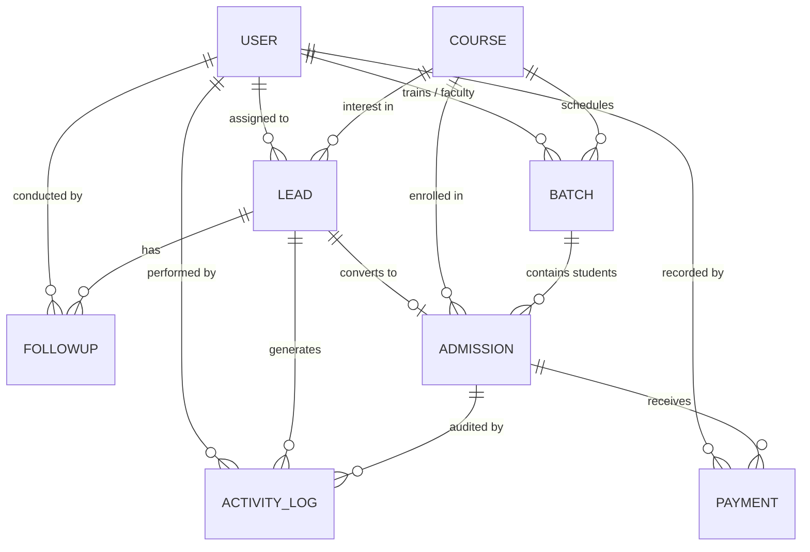

# DATABASE_SCHEMA.md – UniverseByte CRM

> **UniverseByte – Technology Redefined**  
> Database Architecture, Schemas, Indexes & Relationships (MongoDB Atlas + Mongoose)

---

## 1. Database Architecture & Design Principles

UniverseByte CRM utilizes **MongoDB Atlas** with **Mongoose ODM**. The schema design balances relational consistency (via normalized `ObjectId` references) with high-read performance (via targeted denormalization of frequently displayed summary data like student names and course codes).

### Core Principles:
- **Normalization with Targeted Caching:** Heavy entities (Courses, Users, Batches) are normalized. Frequently rendered summaries (e.g., Lead name in FollowUps or Course code in Admissions) are selectively captured or populated to minimize join overhead.
- **Strict Validation:** Every collection enforces Mongoose schema validation, matching Zod schema definitions on the API layer.
- **Index Optimization:** Compound indexes are explicitly created to cover the most critical query paths: counselor pipeline filtering, follow-up date ranges, and phone/email lookups.
- **Atomicity via Transactions:** Multi-document updates (such as converting a Lead into an Admission, incrementing the Batch seat counter, and creating the first payment receipt) execute inside native MongoDB Sessions/Transactions.

---

## 2. Entity-Relationship Diagram (ERD)

---

## 3. Detailed Collection Schemas

### 3.1 Collection: `users`
Stores all staff and administration profiles with authentication credentials and permission roles.

| Field | BSON Type | Required | Unique | Description / Constraints |
| :--- | :--- | :--- | :--- | :--- |
| `_id` | ObjectId | Yes | Yes | Auto-generated MongoDB primary key |
| `fullName` | String | Yes | No | Full name of staff member (trimmed, max 100 chars) |
| `email` | String | Yes | Yes | Corporate email address (lowercase, indexed) |
| `passwordHash` | String | Yes | No | Hashed using bcryptjs (salt rounds >= 10, excluded by default) |
| `phone` | String | Yes | Yes | Contact phone number (E.164 or 10-digit format) |
| `role` | String | Yes | No | Enum: `SuperAdmin`, `Admin`, `CounselorManager`, `Counselor`, `Accountant`, `Trainer` |
| `permissions` | Array[String]| Yes | No | Granular permission overrides (e.g., `["leads:reassign", "fees:discount"]`) |
| `isActive` | Boolean | Yes | No | Account status flag (default: `true`) |
| `lastLoginAt` | Date | No | No | Timestamp of most recent successful login |
| `refreshToken` | String | No | No | Hashed or encrypted active refresh token string (optional for rotation) |
| `createdAt` | Date | Yes | No | Auto-generated timestamp |
| `updatedAt` | Date | Yes | No | Auto-generated timestamp |

#### Indexes:
- `{ email: 1 }` (Unique)
- `{ role: 1, isActive: 1 }` (For counselor assignment lists)

---

### 3.2 Collection: `leads`
The central hub for prospective student inquiries, counseling stages, and lead conversion.

| Field | BSON Type | Required | Unique | Description / Constraints |
| :--- | :--- | :--- | :--- | :--- |
| `_id` | ObjectId | Yes | Yes | Auto-generated primary key |
| `leadNumber` | String | Yes | Yes | Human-readable ID (e.g., `UB-LD-2026-0001`, unique indexed) |
| `fullName` | String | Yes | No | Prospect full name (trimmed, 2-100 chars) |
| `email` | String | No | No | Email address (lowercase, indexed for search) |
| `phone` | String | Yes | No | Primary mobile/WhatsApp number (indexed) |
| `altPhone` | String | No | No | Alternate or parent contact number |
| `city` | String | No | No | Current city of residence |
| `educationQualification` | String | No | No | Highest qualification (e.g., B.Tech, BCA, MCA, B.Sc, Diploma, Working Pro) |
| `collegeOrCompany` | String | No | No | Name of college attended or current employer |
| `graduationYear` | Number | No | No | Year of graduation (e.g., 2024, 2025, 2026) |
| `coursesInterested` | Array[ObjectId] | Yes | No | References to `courses._id` |
| `trainingMode` | String | Yes | No | Enum: `Classroom`, `Online`, `Hybrid`, `Undecided` (Default: `Classroom`) |
| `preferredTimingSlot` | String | No | No | Enum: `Morning`, `Afternoon`, `Evening`, `Weekend`, `Any` |
| `source` | String | Yes | No | Enum: `Website`, `WhatsApp`, `WalkIn`, `GoogleAds`, `MetaAds`, `Referral`, `CampusDrive`, `ColdCall`, `Other` |
| `customSourceDetails` | String | No | No | Additional source notes (e.g., referrer name, ad campaign id) |
| `status` | String | Yes | No | Enum (11 Stages): `New`, `Not Contacted`, `Contacted`, `Interested`, `Counselling Scheduled`, `Demo Scheduled`, `Follow-up Required`, `Negotiation`, `Admission Confirmed`, `Not Interested`, `Lost` |
| `priority` | String | Yes | No | Enum: `Hot`, `Warm`, `Cold` (Default: `Warm`) |
| `lostReason` | String | No | No | Enum: `FeeHigh`, `LocationFar`, `TimingIssue`, `JoinedCompetitor`, `NotInterested`, `FakeEnquiry`, `Other` |
| `lostRemarks` | String | No | No | Additional explanation required when status is `Lost` |
| `assignedTo` | ObjectId | No | No | Reference to `users._id` (Counselor assigned) |
| `assignedBy` | ObjectId | No | No | Reference to `users._id` (Manager/Admin who assigned) |
| `assignedAt` | Date | No | No | Timestamp of lead assignment |
| `nextFollowUpDate` | Date | No | No | Scheduled timestamp for next communication |
| `demoScheduledAt` | Date | No | No | Scheduled timestamp for trial/demo class |
| `notes` | String | No | No | Internal counseling notes |
| `createdAt` | Date | Yes | No | Auto-generated timestamp |
| `updatedAt` | Date | Yes | No | Auto-generated timestamp |

#### Indexes:
- `{ leadNumber: 1 }` (Unique)
- `{ phone: 1 }` (High-frequency search)
- `{ email: 1 }`
- `{ status: 1 }`
- `{ assignedTo: 1, status: 1, nextFollowUpDate: 1 }` (Counselor active dashboard)
- `{ source: 1, createdAt: 1 }` (Source analytics)
- `{ createdAt: -1 }` (Recent leads list)

---

### 3.3 Collection: `followups`
Logs every student counseling call, WhatsApp chat, meeting, or demo session with schedule and completion history.

| Field | BSON Type | Required | Unique | Description / Constraints |
| :--- | :--- | :--- | :--- | :--- |
| `_id` | ObjectId | Yes | Yes | Auto-generated primary key |
| `leadId` | ObjectId | Yes | No | Reference to `leads._id` (indexed) |
| `counsellorId` | ObjectId | Yes | No | Reference to `users._id` (Assigned staff counsellor) |
| `scheduledAt` | Date | Yes | No | Scheduled date and time for contact (indexed) |
| `type` | String | Yes | No | Enum: `Call`, `WhatsApp`, `Meeting`, `Demo` (default: `Call`) |
| `status` | String | Yes | No | Enum: `Scheduled`, `Completed`, `Rescheduled`, `Cancelled` (indexed) |
| `counsellingNotes` | String | Yes | No | Agenda or discussion points entered when scheduled |
| `completedAt` | Date | No | No | Exact timestamp when marked completed by user action |
| `completionRemarks`| String | No | No | Discussion outcome and student response entered upon completion |
| `rescheduledAt` | Date | No | No | Timestamp when rescheduled |
| `rescheduledReason`| String | No | No | Mandatory explanation entered when moving the scheduled slot |
| `history` | Array | Yes | No | Immutable audit log of all changes, dates, notes, and staff user stamps |
| `createdAt` | Date | Yes | No | Auto-generated timestamp |
| `updatedAt` | Date | Yes | No | Auto-generated timestamp |

#### Indexes:
- `{ counsellorId: 1, status: 1, scheduledAt: 1 }` (Counselor active dashboard & section queries)
- `{ leadId: 1, scheduledAt: 1 }` (Lead follow-up timeline & duplicate slot safety guard)
- `{ status: 1, scheduledAt: 1 }` (Overdue alerts & global pipeline tracker)

---

### 3.4 Collection: `courses`
IT training courses and curricula offered by UniverseByte.

| Field | BSON Type | Required | Unique | Description / Constraints |
| :--- | :--- | :--- | :--- | :--- |
| `_id` | ObjectId | Yes | Yes | Auto-generated primary key |
| `code` | String | Yes | Yes | Unique course identifier (e.g., `UB-FSD-01`, uppercase) |
| `title` | String | Yes | No | Full course name (e.g., "Full Stack Web Development (MERN)") |
| `slug` | String | Yes | Yes | URL-friendly slug (e.g., `full-stack-web-development-mern`) |
| `category` | String | Yes | No | Enum: `WebDevelopment`, `CloudDevOps`, `DataScienceAI`, `CyberSecurity`, `SoftwareTesting`, `ProgrammingLanguages` |
| `description` | String | Yes | No | Detailed course overview and value proposition |
| `durationWeeks` | Number | Yes | No | Total course duration in weeks (min: 1) |
| `totalFee` | Number | Yes | No | Standard course fee in INR (min: 0) |
| `maxDiscountPercent`| Number | Yes | No | Maximum permitted counselor discount without manager approval (default: 10) |
| `syllabusModules` | Array[Object]| No | No | Array of `{ title: String, topics: Array[String], durationHours: Number }` |
| `isActive` | Boolean | Yes | No | Available for new admissions (default: `true`) |
| `createdAt` | Date | Yes | No | Auto-generated timestamp |
| `updatedAt` | Date | Yes | No | Auto-generated timestamp |

#### Indexes:
- `{ code: 1 }` (Unique)
- `{ slug: 1 }` (Unique)
- `{ category: 1, isActive: 1 }`

---

### 3.5 Collection: `batches`
Specific cohorts/schedules for a course, with assigned faculty and timing slots.

| Field | BSON Type | Required | Unique | Description / Constraints |
| :--- | :--- | :--- | :--- | :--- |
| `_id` | ObjectId | Yes | Yes | Auto-generated primary key |
| `batchCode` | String | Yes | Yes | Unique batch code (e.g., `UB-B-2026-FSD-01`) |
| `courseId` | ObjectId | Yes | No | Reference to `courses._id` |
| `trainerId` | ObjectId | No | No | Reference to `users._id` (Faculty/Trainer) |
| `name` | String | Yes | No | Human-readable batch name (e.g., "MERN Morning Cohort A") |
| `mode` | String | Yes | No | Enum: `Classroom`, `Online`, `Hybrid` |
| `timingSlot` | String | Yes | No | Enum: `Morning_8_10AM`, `Morning_10_12PM`, `Evening_6_8PM`, `Weekend_Batch` |
| `daysOfWeek` | Array[String]| Yes | No | e.g., `["Mon", "Wed", "Fri"]` or `["Sat", "Sun"]` |
| `startDate` | Date | Yes | No | Target start date |
| `endDate` | Date | No | No | Target completion date |
| `capacity` | Number | Yes | No | Maximum allowed students (default: 30) |
| `enrolledCount` | Number | Yes | No | Current enrolled student count (default: 0) |
| `status` | String | Yes | No | Enum: `Upcoming`, `Ongoing`, `Completed`, `Cancelled` (Default: `Upcoming`) |
| `createdAt` | Date | Yes | No | Auto-generated timestamp |
| `updatedAt` | Date | Yes | No | Auto-generated timestamp |

#### Indexes:
- `{ batchCode: 1 }` (Unique)
- `{ courseId: 1, status: 1 }`
- `{ trainerId: 1, status: 1 }`
- `{ startDate: 1 }`

---

### 3.6 Collection: `admissions`
Official enrollment records converted from qualified leads.

| Field | BSON Type | Required | Unique | Description / Constraints |
| :--- | :--- | :--- | :--- | :--- |
| `_id` | ObjectId | Yes | Yes | Auto-generated primary key |
| `admissionNumber` | String | Yes | Yes | Unique registration ID (e.g., `UB-ADM-2026-0042`) |
| `leadId` | ObjectId | Yes | Yes | Reference to original `leads._id` (One-to-one) |
| `studentName` | String | Yes | No | Captured snapshot of student full name |
| `studentEmail` | String | No | No | Student contact email |
| `studentPhone` | String | Yes | No | Primary phone number |
| `courseId` | ObjectId | Yes | No | Reference to `courses._id` |
| `batchId` | ObjectId | Yes | No | Reference to `batches._id` |
| `counselorId` | ObjectId | Yes | No | Reference to `users._id` (Closing counselor) |
| `admissionDate` | Date | Yes | No | Date of admission registration |
| `standardFee` | Number | Yes | No | Original course fee |
| `discountAmount` | Number | Yes | No | Scholarship / discount granted (default: 0) |
| `discountApprovedBy`| ObjectId| No | No | Reference to `users._id` (Manager who authorized discount) |
| `netPayableFee` | Number | Yes | No | Computed: `standardFee - discountAmount` |
| `totalPaid` | Number | Yes | No | Sum of confirmed payments (default: 0) |
| `balanceAmount` | Number | Yes | No | Computed: `netPayableFee - totalPaid` |
| `paymentStatus` | String | Yes | No | Enum: `PendingPayment`, `PartiallyPaid`, `FullyPaid`, `Refunded` |
| `paymentPlan` | String | Yes | No | Enum: `OneTime`, `TwoInstallments`, `ThreeInstallments`, `Custom` |
| `installmentsSchedule`| Array[Object]| No | No | Array of `{ installmentNo: Number, dueDate: Date, amount: Number, status: String }` |
| `remarks` | String | No | No | Administrative or payment agreement remarks |
| `createdAt` | Date | Yes | No | Auto-generated timestamp |
| `updatedAt` | Date | Yes | No | Auto-generated timestamp |

#### Indexes:
- `{ admissionNumber: 1 }` (Unique)
- `{ leadId: 1 }` (Unique)
- `{ batchId: 1, paymentStatus: 1 }`
- `{ counselorId: 1, admissionDate: 1 }`
- `{ paymentStatus: 1, balanceAmount: 1 }` (For accounts receivables)

---

### 3.7 Collection: `payments`
Immutable financial transaction logs for student fee installments.

| Field | BSON Type | Required | Unique | Description / Constraints |
| :--- | :--- | :--- | :--- | :--- |
| `_id` | ObjectId | Yes | Yes | Auto-generated primary key |
| `receiptNumber` | String | Yes | Yes | Financial receipt ID (e.g., `UB-REC-2026-0158`) |
| `admissionId` | ObjectId | Yes | No | Reference to `admissions._id` (indexed) |
| `amount` | Number | Yes | No | Amount received in INR (min: 1) |
| `paymentMethod` | String | Yes | No | Enum: `UPI`, `NetBanking`, `DebitCard`, `CreditCard`, `Cash`, `BankTransfer`, `Cheque` |
| `transactionReference`| String | No | No | Bank UTR / UPI transaction ID / Cheque number |
| `paymentDate` | Date | Yes | No | Date payment was realized |
| `receiptStatus` | String | Yes | No | Enum: `Confirmed`, `Bounced`, `Refunded` (Default: `Confirmed`) |
| `recordedBy` | ObjectId | Yes | No | Reference to `users._id` (Accountant/Admin who accepted payment) |
| `notes` | String | No | No | Payment comments |
| `createdAt` | Date | Yes | No | Auto-generated timestamp |
| `updatedAt` | Date | Yes | No | Auto-generated timestamp |

#### Indexes:
- `{ receiptNumber: 1 }` (Unique)
- `{ admissionId: 1, paymentDate: -1 }`
- `{ paymentDate: 1, receiptStatus: 1 }` (Financial daily closing reports)

---

### 3.8 Collection: `activity_logs`
Immutable audit log recording critical operational events across the CRM.

| Field | BSON Type | Required | Unique | Description / Constraints |
| :--- | :--- | :--- | :--- | :--- |
| `_id` | ObjectId | Yes | Yes | Auto-generated primary key |
| `entityType` | String | Yes | No | Enum: `Lead`, `Admission`, `Batch`, `Course`, `User`, `Payment` |
| `entityId` | ObjectId | Yes | No | ID of affected entity |
| `action` | String | Yes | No | Enum: `CREATED`, `UPDATED`, `STATUS_CHANGED`, `REASSIGNED`, `DELETED`, `PAYMENT_RECORDED`, `LOGIN` |
| `performedBy` | ObjectId | Yes | No | Reference to `users._id` |
| `changes` | Object | No | No | Diff payload containing `{ before: Object, after: Object }` |
| `description` | String | Yes | No | Human-readable explanation (e.g., "Lead assigned to Counselor John") |
| `ipAddress` | String | No | No | Client IP address |
| `userAgent` | String | No | No | Browser/device user agent |
| `createdAt` | Date | Yes | No | Timestamp of event |

#### Indexes:
- `{ entityType: 1, entityId: 1, createdAt: -1 }` (Entity timeline)
- `{ performedBy: 1, createdAt: -1 }` (User activity log)
- `{ action: 1, createdAt: -1 }`
- `{ createdAt: 1 }` with TTL index (e.g., 365 days retention if desired)

---

### 3.9 Collection: `whatsapp_messages`
Stores all student communication records distinguishing between manual Click-to-WhatsApp attempts and confirmed Meta Cloud API deliveries.

| Field | BSON Type | Required | Unique | Description / Constraints |
| :--- | :--- | :--- | :--- | :--- |
| `_id` | ObjectId | Yes | Yes | Auto-generated primary key |
| `leadId` | ObjectId | No | No | Reference to `leads._id` (indexed) |
| `studentName` | String | Yes | No | Student full name snapshot |
| `phoneNumber` | String | Yes | No | E.164 formatted phone number (e.g., `919876543210`) |
| `direction` | String | Yes | No | Enum: `outbound`, `inbound` |
| `method` | String | Yes | No | Enum: `manual_click`, `meta_api` |
| `type` | String | Yes | No | Enum: `template`, `text`, `interactive` |
| `templateName` | String | No | No | Enum: `new_enquiry`, `followup`, `counselling`, `demo`, `admission`, `custom` |
| `language` | String | Yes | No | Enum: `en`, `hi`, `hinglish` |
| `messageBody` | String | Yes | No | Complete rendered message content |
| `metaMessageId` | String | No | Sparse | Meta Cloud API message ID (`wamid.xxx`) |
| `status` | String | Yes | No | Enum: `attempted`, `pending`, `sent`, `delivered`, `read`, `failed` |
| `statusHistory` | Array[Object]| Yes | No | `[{ status: String, timestamp: Date, details: String }]` |
| `errorMessage` | String | No | No | Error details if delivery failed |
| `senderId` | ObjectId | No | No | Reference to `users._id` (Staff member) |
| `metadata` | Object | No | No | Additional payload / Meta webhook context |
| `createdAt` | Date | Yes | No | Auto-generated timestamp |
| `updatedAt` | Date | Yes | No | Auto-generated timestamp |

#### Indexes:
- `{ leadId: 1, createdAt: -1 }`
- `{ metaMessageId: 1 }` (Sparse)
- `{ method: 1, status: 1, createdAt: -1 }`
- `{ phoneNumber: 1, createdAt: -1 }`

