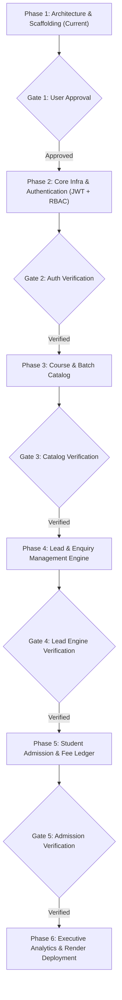

# DEVELOPMENT_ROADMAP.md – UniverseByte CRM

> **UniverseByte – Technology Redefined**  
> Phased Implementation Roadmap & Verification Gates

---

## Roadmap Overview

This roadmap defines the sequential, gate-controlled implementation plan for **UniverseByte CRM**. Each phase must pass rigorous verification criteria before proceeding to the subsequent phase.

---

## Phase 1: Architecture, Scaffolding & Specifications (Current Phase)

- [x] Analyze CRM requirements for IT Training institute operations.
- [x] Design complete layered architecture for backend and feature-driven architecture for frontend.
- [x] Configure npm workspaces monorepo (`package.json`, `backend/`, `frontend/`, `docs/`).
- [x] Establish backend configuration: TypeScript, ESM, Zod, Mongoose, Express.
- [x] Establish frontend configuration: Vite, React 18, TypeScript, Tailwind CSS, shadcn/ui.
- [x] Prepare comprehensive MongoDB database schema and relationships design (`DATABASE_SCHEMA.md`).
- [x] Prepare exhaustive REST API specification (`API_DOCUMENTATION.md`).
- [x] Create permanent agent rules (`AGENTS.md`).
- [x] Create project documentation (`README.md`).
- [x] Prepare infrastructure-as-code for Render deployment (`render.yaml`).
- [ ] **Verification Gate 1:** Present architectural blueprints and obtain explicit user sign-off prior to code implementation.

---

## Phase 2: Core Infrastructure, Database & Authentication Engine

### Backend Deliverables
- [x] Establish MongoDB Atlas connection utility with automatic reconnects and connection pooling.
- [x] Implement standardized response wrapper (`ApiResponse`) and error class (`ApiError`).
- [x] Implement central error handling middleware and async handler.
- [x] Implement `User` model with secure `bcryptjs` password hashing, salts, and role definitions (`SuperAdmin`, `Admin`, `AdmissionCounsellor`, `Telecaller`, `MarketingManager`).
- [x] Implement JWT authentication service:
  - Access token generation (short-lived, 15m).
  - Refresh token generation and secure cookie / storage verification (7d).
- [x] Implement `requireAuth` authentication middleware and `requireRoles(...)` / `requirePermissions(...)` RBAC middleware.
- [x] Implement Zod validation middleware for all request payloads.
- [x] Implement authentication endpoints:
  - `POST /api/v1/auth/login`
  - `POST /api/v1/auth/refresh-token`
  - `GET /api/v1/auth/me`
  - `POST /api/v1/auth/logout`
  - `POST /api/v1/auth/change-password`
  - `POST /api/v1/auth/forgot-password`
  - `POST /api/v1/auth/reset-password`
- [x] Implement user management endpoints for Admin/SuperAdmin (`/api/v1/users`).
- [x] Implement initial Super Admin database seeding script (`backend/src/scripts/seed-admin.ts`).
- [x] Health check endpoint: `GET /api/v1/health` (validating database connection state, memory, and uptime).

### Frontend Deliverables
- [x] Setup Axios HTTP client with request and response interceptors (automatic token refresh queue & error notifications).
- [x] Setup global `AuthContext` with login, logout, and token session restoration.
- [x] Setup `ProtectedRoute` and `RoleGuard` route guards for client-side navigation.
- [x] Build Authentication UI:
  - Professional login page branded with **UniverseByte – Technology Redefined**.
  - Form validation, error alerts, password toggle, and forgot password modal.
- [x] Build Application Layout shell:
  - Collapsible Sidebar with navigation items dynamically filtered by role.
  - Top Navbar with user profile badge, active role badge, and logout trigger.
- [x] Build Staff Management page (`/staff`):
  - Add staff modal with role assignment and validation.
  - Edit staff modal.
  - Activate / Deactivate staff toggling.
- [x] Build User Profile page (`/profile`):
  - Profile details, change password form, and login activity audit table.
- [x] Build Unauthorized page (`/unauthorized`).

### Verification Gate 2 (Passed: 13 / 13 Tests Passing)
- [x] Successful user login with JWT issuance and secure cookie (`POST /auth/login`).
- [x] Invalid password and non-existent user handling (`401 Unauthorized`).
- [x] Deactivated user rejection (`403 Forbidden`).
- [x] Protected route access with valid Bearer token (`GET /auth/me`).
- [x] Protected route rejection without token (`401 Unauthorized`).
- [x] Protected route rejection with invalid/tampered token (`401 Unauthorized`).
- [x] Protected route rejection with expired token (`401 Unauthorized`).
- [x] RBAC enforcement forbidding Telecaller from accessing Admin-only routes (`403 Forbidden`).
- [x] Token refresh endpoint rotation and invalid token rejection.
- [x] Clean logout clearing session and HTTP-only cookie.
- [x] TypeScript builds for both backend and frontend compile with 0 errors.

---

## Phase 3: UniverseByte Lead & Enquiry Management Engine (Completed & Verified)

### Deliverables Completed
- [x] Auto-generated unique Lead ID in `UB-LD-YYYY-XXXX` format.
- [x] Strict duplicate mobile number detection before insertion (rejects with `409 Conflict`, never silently overwrites).
- [x] All 21 required Lead fields implemented:
  - `leadId`, `studentName`, `mobileNumber`, `whatsappNumber`, `email`, `city`, `college`, `qualification`, `graduationYear`
  - `interestedCourse` (all 13 specified options)
  - `leadSource` (all 10 specified channels: Website, WhatsApp, Google Ads, Facebook Ads, Instagram, Phone Call, Walk-in, Referral, Justdial, Other)
  - `campaign`, `assignedCounsellor`, `status`, `priority`, `budget`, `expectedAdmissionDate`, `nextFollowUpDate`, `remarks`, `createdAt`, `updatedAt`
- [x] Data isolation & access control:
  - Telecallers and Admission Counsellors strictly restricted to their assigned leads.
  - SuperAdmin, Admin, and MarketingManager can view and manage all leads.
- [x] Full CRUD operations:
  - Create lead (`POST /api/v1/leads`)
  - Edit lead (`PUT /api/v1/leads/:id`)
  - View lead (`GET /api/v1/leads/:id`)
  - Soft delete lead (`DELETE /api/v1/leads/:id`)
  - Restore deleted lead (`PATCH /api/v1/leads/:id/restore`)
  - Permanent deletion (`DELETE /api/v1/leads/:id/permanent` - SuperAdmin only)
- [x] Activity history audit trail:
  - Records every change, old/new value diffs, author, timestamp, and notes.
- [x] Search, Advanced Filters, Sorting & Database Pagination:
  - Search by student name, phone, WhatsApp, email, or Lead ID.
  - Filter by Course, Source, Status, Priority, Counsellor, Date range, Trash view.
  - Sort by newest, oldest, priority (Hot/Warm/Cold), and next follow-up date.
  - Database-backed pagination (`skip`, `limit`, `totalRecords`, `totalPages`).
- [x] Bulk lead assignment (`POST /api/v1/leads/bulk-assign`).
- [x] RFC-compliant CSV Export (`GET /api/v1/leads/export/csv`).
- [x] CSV Batch Import (`POST /api/v1/leads/import`) with batch duplicate rejection.
- [x] Complete Frontend Interface:
  - `LeadsPage`: table, search, filters, pagination, batch assignment bar.
  - `LeadFormModal`: create & edit modal with live mobile duplication detection banner.
  - `LeadDetailDrawer`: 360° lead card with click-to-call, WhatsApp direct chat link, and chronological activity timeline.
  - `BulkAssignModal`: multi-lead counsellor reassignment.
  - `ImportLeadsModal`: CSV file upload & sample template download.

### Verification Gate 3 (Passed: 19 Lead Tests + 13 Auth Tests = 32 Tests Total)
- [x] 1.1 Create lead with auto-generated Lead ID: PASS
- [x] 1.2 Reject duplicate mobile numbers: PASS (409 Conflict)
- [x] 1.3 Reject invalid mobile number formats: PASS (400 Bad Request)
- [x] 2.1 Live duplicate check endpoint detects existing lead: PASS
- [x] 2.2 Live duplicate check reports unique number as free: PASS
- [x] 3.1 Database-backed pagination: PASS
- [x] 3.2 Full-text search by student name: PASS
- [x] 3.3 Course and Priority filtering: PASS
- [x] 4.1 Counsellor 1 can access assigned lead: PASS
- [x] 4.2 Counsellor 2 is forbidden from viewing Counsellor 1's lead: PASS (403 Forbidden)
- [x] 5.1 Update lead records exact field diffs in activity history: PASS
- [x] 6.1 Soft delete lead moves to trash: PASS
- [x] 6.2 Soft deleted lead hidden from active pipeline: PASS
- [x] 6.3 Soft deleted lead visible in trash view: PASS
- [x] 6.4 Restore lead returns record to active list: PASS
- [x] 7.1 Permanent deletion rejected for Counsellor: PASS (403 Forbidden)
- [x] 7.2 Permanent deletion permitted for Super Admin: PASS
- [x] 8.1 Bulk assign reassigns multiple leads with activity logs: PASS
- [x] 9.1 CSV Export delivers RFC-compliant formatted data: PASS

---

## Phase 4: Lead Pipeline Kanban Board (Completed & Verified)

### Backend Deliverables Completed
- [x] Standardized 11 Pipeline Stages:
  1. `New`
  2. `Not Contacted`
  3. `Contacted`
  4. `Interested`
  5. `Counselling Scheduled`
  6. `Demo Scheduled`
  7. `Follow-up Required`
  8. `Negotiation`
  9. `Admission Confirmed`
  10. `Not Interested`
  11. `Lost`
- [x] Status transition endpoint (`PATCH /api/v1/leads/:id/status`):
  - Validates target status against strict enum via Zod.
  - Role-based authorization: Telecallers & Admission Counsellors strictly restricted from modifying other staff's leads (`403 Forbidden`).
  - Immutable activity history recording (`STATUS_CHANGED` action with old & new stage, user stamp, and transition remarks).
  - MongoDB Atlas persistence with updated timestamps.
- [x] Kanban Pipeline leads retrieval endpoint (`GET /api/v1/leads/kanban`):
  - Fetches all active non-deleted leads sorted by `updatedAt: -1`.
  - Full-text search and filtering by date range, course, lead source, priority, and assigned counsellor.
  - Populates counsellor relationship (`fullName`, `email`, `phone`, `role`).

### Frontend Deliverables Completed
- [x] Interactive Kanban Board (`features/leads/KanbanBoard.tsx`):
  - 11 horizontal columns with distinct color accents, stage badges, lead counters, and potential fee value aggregates.
  - Native HTML5 Drag and Drop (`draggable`, `onDragStart`, `onDragOver`, `onDrop`) with visual dropzone highlights.
  - Lead cards displaying student name, mobile number, interested course badge, priority flame badge (Hot/Warm/Cold), Lead ID, assigned counsellor, and next follow-up date indicator.
  - One-click direct Call (`tel:`) and direct WhatsApp (`wa.me`) integration.
  - Quick "Edit Lead" and "View Details" actions directly from cards.
- [x] Milestone Confirmation Modals:
  - `Admission Confirmed` confirmation modal with optional admission remarks / fee receipt input.
  - `Lost` confirmation modal with structured loss reason selector (Fee issue, joined competitor, distance, timings, etc.) and notes textarea.
- [x] Pipeline Filters Bar:
  - Real-time search by student name, phone, or Lead ID.
  - Date preset filter (All Time, Created Today, Past 7 Days, Past 30 Days).
  - Course, Source, Priority, and Counsellor dropdown filters.
  - One-click filter reset and animated pipeline refresh button.
- [x] View Mode Switcher in `LeadsPage.tsx`:
  - Toggle between `[ Kanban Pipeline | Table View ]` with user preference persisted in `localStorage`.
  - Smooth integration with `LeadDetailDrawer`, `LeadFormModal`, and `BulkAssignModal`.

### Verification Gate 4 (Passed: 38 / 38 Automated Tests Passing)
- [x] 10.1 Lead status update and `STATUS_CHANGED` activity history logging: PASS
- [x] 10.2 Persistence verification after fetching lead by ID: PASS
- [x] 10.3 Transition to `Admission Confirmed` and persistence: PASS
- [x] 10.4 Rejection of invalid pipeline status: PASS (400 Bad Request)
- [x] 10.5 Authorization check preventing unauthorized staff from updating other staff's leads: PASS (403 Forbidden)
- [x] 11.1 Fetching active Kanban pipeline leads: PASS
- [x] TypeScript builds for both backend (`tsc`) and frontend (`tsc -b && vite build`) compile with 0 errors.

---

## Phase 5: Follow-up Management Engine (Completed & Verified)

### Backend Deliverables Completed
- [x] FollowUp Model (`backend/src/models/followup.model.ts`):
  - Every follow-up is connected to a Lead (`leadId`) and assigned to a Counsellor (`counsellorId`).
  - Follow-up channels: `Call`, `WhatsApp`, `Meeting`, `Demo`.
  - Follow-up statuses: `Scheduled`, `Completed`, `Rescheduled`, `Cancelled`.
  - Full audit history array on each record with user stamping, old/new dates, and remarks.
  - Compound indexes for date-range and counselor pipeline performance.
- [x] Accidental Duplicate Slot Prevention:
  - Guard ensures no active follow-up (`Scheduled` or `Rescheduled`) can be scheduled for the same lead within a ±15-minute window (`409 Conflict`).
- [x] Date-based & Section Filtering Engine:
  - `Today's Follow-ups`: Scheduled between 00:00:00 and 23:59:59 today.
  - `Overdue Follow-ups`: Scheduled prior to current time and still pending (`Scheduled` or `Rescheduled`).
  - `Upcoming Follow-ups`: Scheduled for future dates beyond today.
  - `Completed Follow-ups`: Formally finalized with mandatory outcome remarks.
- [x] Explicit User Action Enforcement:
  - Follow-ups are never automatically marked completed. Require conscious user action via `PATCH /api/v1/followups/:id/complete` with discussion remarks.
- [x] State Transitions & Rescheduling:
  - `PATCH /api/v1/followups/:id/reschedule` moves scheduled time, updates connected lead `nextFollowUpDate`, and logs in lead activity history.
- [x] Aggregation Endpoints:
  - `GET /api/v1/followups/reminders` (Dashboard urgency breakdown).
  - `GET /api/v1/followups/counsellor-metrics` (Counts per counsellor: Today, Overdue, Upcoming, Completed).
  - `GET /api/v1/followups/lead/:leadId` (Specific lead follow-up history).

### Frontend Deliverables Completed
- [x] FollowupsPage (`features/followups/FollowupsPage.tsx`):
  - 4 Tabbed Views: 📅 Today's Follow-ups, 🚨 Overdue Follow-ups, ⏳ Upcoming Follow-ups, ✅ Completed Follow-ups.
  - Prominent Overdue Urgency Alert Banner with overdue duration counters.
  - Cards displaying student details, course, call action, whatsapp action, complete button, reschedule button, view lead drawer, and activity history modal.
  - Filters toolbar: Search (name, phone, Lead ID), Channel dropdown, Counsellor dropdown.
  - Per-counsellor metrics summary cards.
- [x] Modals:
  - `ScheduleFollowupModal.tsx`: Date/time picker, type selector, lead selector/search, counsellor assign, counselling notes.
  - `CompleteFollowupModal.tsx`: Explicit completion remarks and optional schedule next follow-up toggle.
  - `RescheduleFollowupModal.tsx`: New date/time picker, quick chips for reschedule reasons, reason textarea.
  - `FollowupHistoryModal.tsx`: Chronological timeline viewer.
- [x] Dashboard Integration (`features/dashboard/DashboardPage.tsx`):
  - Follow-up Reminders overview cards (Today's, Overdue, Completed Today, Upcoming).
  - Overdue quick-action alert box with direct Call and WhatsApp shortcuts.
- [x] LeadDetailDrawer Integration:
  - Follow-up section displaying past and scheduled follow-ups for that lead.
  - "Schedule Follow-up" quick button in drawer header.
- [x] Navigation:
  - Added "Follow-ups" link in sidebar layout (`AppLayout.tsx`) and route in `AppRoutes.tsx`.

### Verification Gate 5 (Passed: 52 / 52 Automated Tests Passing)
- [x] 1.1 Schedule follow-up with date, time, type, notes: PASS
- [x] 1.2 Prevent accidental duplicate follow-up within 15-minute slot window: PASS (409 Conflict)
- [x] 1.3 Reject scheduling with invalid follow-up type: PASS (400 Bad Request)
- [x] 1.4 Reject scheduling for non-existent lead: PASS (404 Not Found)
- [x] 2.1 List follow-ups with database pagination: PASS
- [x] 2.2 Filter follow-ups by upcoming section: PASS
- [x] 2.3 Filter follow-ups by type: PASS
- [x] 3.1 Reschedule follow-up with new date and record reason: PASS
- [x] 4.1 Mark follow-up completed with remarks and update lead activity history: PASS
- [x] 4.2 Reject completing an already completed follow-up: PASS (400 Bad Request)
- [x] 5.1 Fetch dashboard reminders breakdown: PASS
- [x] 5.2 Fetch follow-up counts per counsellor breakdown: PASS
- [x] 6.1 Counsellor 1 is forbidden from completing Counsellor 2 follow-up: PASS (403 Forbidden)
- [x] 6.2 Counsellor 1 is forbidden from viewing Counsellor 2 follow-up: PASS (403 Forbidden)
- [x] Full monorepo production build (`npm run build`) compiles with 0 errors.

---

## Phase 6: Student Admission, Enrollment & Fee Tracking Module

### Backend Deliverables
- [ ] Implement `Admission` model:
  - Converts a lead to an enrolled student record with unique admission number (`UB-YYYY-XXXX`).
  - Links to `Lead`, `Course`, and `Batch`.
  - Financial summary: Total agreed fee, scholarship/discount granted, net payable fee, payment plan (`Full`, `2-Installments`, `3-Installments`, `Custom`).
- [ ] Implement `Payment` model:
  - Tracks individual installment receipts (receiptNumber, admissionId, amount, paymentMethod, transactionRef, paymentDate, recordedBy).
  - Automatic balance calculation and installment due date tracking.
- [ ] Admission service with MongoDB transaction ensuring batch seat count increment and lead stage update to `Enrolled`.

### Frontend Deliverables
- [ ] Convert Lead to Admission Wizard:
  - Step 1: Confirm student details & batch selection.
  - Step 2: Configure fee, discounts, and installment schedule.
  - Step 3: Record initial registration / down-payment fee.
- [ ] Student Admissions Ledger:
  - Searchable list of enrolled students with payment status (`Paid in Full`, `Partially Paid`, `Overdue`).
  - Admission detail page with payment timeline and printable receipt modal.
- [ ] Accounts View:
  - Collection ledger for accountant role to record incoming payments.

### Verification Gate 5
- Lead conversion executes atomically in MongoDB transactions.
- Batch enrolled count updates accurately and prevents overbooking beyond capacity.
- Fee balances recalculate automatically upon payment entry.

---

## Phase 6: Executive Analytics, Dynamic Dashboard & Domain Reports (Completed)

### Backend Deliverables
- [x] Implemented `AnalyticsService` (`backend/src/services/analytics.service.ts`):
  - `getDateBoundaries`: Exact temporal boundaries for presets (`today`, `yesterday`, `last7days`, `last30days`, `thismonth`, `custom`).
  - `getDashboardCards`: MongoDB `$facet` aggregation computing all 10 core KPI cards + revenue potential.
  - `getDashboardCharts`: Aggregations for Daily generation, Monthly generation (past 6 months), Source-wise distribution, Course-wise enquiries, Counsellor performance (with `$lookup` on `users`), and Admission conversion trends.
  - `getReportData`: Domain aggregations for all 7 reports (`source`, `course`, `counsellor`, `admission`, `lost`, `followup`, `campaign`).
  - `exportReportCsv`: RFC-compliant CSV generator streaming properly escaped headers and values.
  - Strict RBAC data scoping: Admission Counsellors & Telecallers automatically scoped to their assigned records.
- [x] Implemented `AnalyticsController` (`backend/src/controllers/analytics.controller.ts`) and routes (`backend/src/routes/analytics.routes.ts`):
  - `GET /api/v1/analytics/cards`
  - `GET /api/v1/analytics/charts`
  - `GET /api/v1/analytics/reports`
  - `GET /api/v1/analytics/reports/export`
- [x] Zod query schemas (`backend/src/validators/analytics.validator.ts`) for validation.

### Frontend Deliverables
- [x] TypeScript contracts and interfaces (`frontend/src/types/analytics.ts`).
- [x] API Client Service (`frontend/src/services/analytics.service.ts`).
- [x] Executive Dashboard (`frontend/src/features/dashboard/DashboardPage.tsx`):
  - Presets filter bar (`Today`, `Yesterday`, `Last 7 Days`, `Last 30 Days`, `This Month`, `Custom Date Range`).
  - Counsellor dropdown filter for privileged roles (`SuperAdmin`, `Admin`, `MarketingManager`).
  - 10 Core KPI Cards: Total Leads, Today's Leads, New Enquiries, Contacted, Interested, Follow-up Due, Overdue, Admissions, Lost Leads, Conversion Rate (with pipeline revenue).
  - 6 Responsive SVG/Tailwind Visualizations: Daily generation, Monthly 6-month growth, Source distribution, Course enquiries & revenue, Counsellor performance table, and Conversion trends.
  - Overdue follow-up alert panel with direct WhatsApp and Call actions.
  - Quick action links to Kanban, Follow-ups, and Reports.
- [x] Reports & Analytics Page (`frontend/src/features/reports/ReportsPage.tsx`):
  - Tabbed interface for all 7 reports.
  - One-click CSV export trigger with browser file download.
  - Responsive tables with status badges, currency formatting (₹), and conversion rates.
- [x] Navigation & Routing:
  - Mounted `/reports` route in `AppRoutes.tsx`.
  - Added "Reports & Analytics" icon link in `AppLayout.tsx`.

### Verification Gate 6 (Passed: 66 / 66 Automated Tests Passing)
- [x] 1.1 All 10 KPI cards with valid aggregations: PASS
- [x] 1.2 Custom date range filters: PASS
- [x] 1.3 Role-based data scoping for counsellor: PASS
- [x] 1.4 Reject unauthenticated requests: PASS (401 Unauthorized)
- [x] 2.1 All 6 chart datasets successfully returned: PASS
- [x] 3.1 Lead Source report: PASS
- [x] 3.2 Course Enquiry report: PASS
- [x] 3.3 Counsellor Performance report: PASS
- [x] 3.4 Admission report: PASS
- [x] 3.5 Lost Lead report: PASS
- [x] 3.6 Follow-up report: PASS
- [x] 3.7 Campaign report: PASS
- [x] 3.8 Reject invalid report type: PASS (400 Bad Request)
- [x] 4.1 RFC-compliant CSV export with escaped headers and values: PASS
- [x] Monorepo production build (`npm run build`) compiles with 0 errors.

---

## Phase 7: UniverseByte WhatsApp Integration (Completed)

### Dual-Method Communication Architecture
1. **Method A: Manual Click-to-WhatsApp**
   - Click-to-WhatsApp action integrated on every lead across Kanban, Lead Drawer, and Lead Management table.
   - Dynamic message generator supporting English, Hindi (हिंदी in Devanagari), and Hinglish (conversational Romanized Hindi/English).
   - 5 Standardized Business Scenarios: `New Enquiry`, `Follow-up`, `1-on-1 Counselling`, `Demo Class`, `Admission Confirmed` (+ Custom compose).
   - Dynamic interpolation of `studentName`, `course`, `counsellorName`, and `instituteName` ("UniverseByte – Technology Redefined").
   - Distinct audit tracking: manual communication attempts recorded with `method: 'manual_click'` and `status: 'attempted'`, strictly separated from confirmed delivered messages (no fake delivered status).
2. **Method B: Official Meta WhatsApp Cloud API**
   - Meta Cloud API configuration with environment variable protection (`WHATSAPP_TOKEN`, `WHATSAPP_PHONE_NUMBER_ID`, `WHATSAPP_BUSINESS_ACCOUNT_ID`, `WHATSAPP_WEBHOOK_VERIFY_TOKEN`).
   - Webhook verification challenge handler (`GET /api/v1/whatsapp/webhook`).
   - Real-time webhook delivery ingestion (`POST /api/v1/whatsapp/webhook`) tracking `sent`, `delivered`, `read`, and `failed` events with deduplication.
   - Inbound student message receiver with lead phone matching and activity history logging.
   - Outgoing messaging API (`POST /api/v1/whatsapp/send-official`).
   - Graceful fallback: when Meta credentials are not configured, official API is marked as "Pending Configuration" and manual Click-to-WhatsApp remains 100% operational.
3. **Dedicated WhatsApp Settings & Communication Hub (`/whatsapp`)**:
   - Status & Credentials health inspection.
   - Webhook URL & verify token display with one-click copy.
   - Step-by-step Meta Developer App configuration guide.
   - Interactive Pre-built Template Viewer across English, Hindi, and Hinglish.
   - Communication History & Audit Log table with method filters and pagination.

### Verification Gate 7 (Passed: 78 / 78 Automated Tests Passing)
- [x] 1.1 Config status returned without exposing secrets: PASS
- [x] 1.2 Multi-lingual templates returned: PASS
- [x] 2.1 English message & Click-to-WhatsApp link generated: PASS
- [x] 2.2 Hindi message generated with Devanagari script: PASS
- [x] 2.3 Hinglish message generated: PASS
- [x] 2.4 Manual Click-to-WhatsApp attempt recorded with status "attempted" & lead log: PASS
- [x] 3.1 Reject official send when credentials missing (no fake status): PASS (400 Bad Request)
- [x] 3.2 Verify Meta webhook challenge with verify token: PASS
- [x] 3.3 Reject invalid webhook challenge: PASS (403 Forbidden)
- [x] 3.4 Ingest Meta webhook delivery status updates: PASS
- [x] 4.1 Lead communication timeline history: PASS
- [x] 4.2 Paginated audit logs with method distinction: PASS
- [x] Monorepo production build (`npm run build`) compiles with 0 errors.

---

## Phase 8: UniverseByte AI CRM Assistant using Groq API (Completed)

### Core Capabilities & Architecture
1. **Llama 3.3 70B via Groq Cloud API:**
   - Ultra-fast token inference powered by Groq LPU technology.
   - Configured via `GROQ_API_KEY`, `GROQ_MODEL` (default: `llama-3.3-70b-versatile`), and `GROQ_TIMEOUT_MS`.
   - Dedicated rate-limiting (`express-rate-limit`: 60 requests per 15 minutes) and Zod schema validation.
   - High-speed in-memory TTL caching with auto-purge to avoid redundant API queries.
   - Intelligent local fallback: If `GROQ_API_KEY` is not present, activates a local domain rule engine ensuring 100% continuous uptime.

2. **Lead Conversion Scoring (0–100):**
   - Categorizes leads into `Hot`, `Warm`, and `Cold` based on inquiry source, interaction frequency, qualification, budget, and follow-up history.
   - Provides concrete, human-readable justification reasons for the score.
   - Suggests pipeline priority (`Hot`, `Warm`, `Cold`).

3. **Intelligent Follow-up Assistant:**
   - Analyzes recent notes and timeline to propose the **Next Best Action**.
   - Recommends the optimal contact window / timing.
   - Generates tailored counselling bullet points and a personalized call opening script.

4. **Multilingual AI WhatsApp Message Generator:**
   - Supports English, Hindi (हिंदी in authentic Devanagari script), and Hinglish (conversational Romanized Hindi/English).
   - Generates tone-specific drafts (`friendly`, `professional`, `urgent`, `motivational`).
   - Supports multiple scenarios: `new_enquiry`, `followup`, `counselling`, `demo`, `admission`, `discount_offer`, and `urgent_reminder`.

5. **AI Lead Summarizer & Hesitation Detector:**
   - Produces an executive timeline brief of all counselling notes and lead interactions.
   - Identifies candidate hesitations, unaddressed doubts, and unanswered questions.
   - Recommends clear next steps for the assigned counselor.

6. **Lost Leads Conversion Analytics:**
   - Aggregates historical dropped leads with course, source, and counselor filtering.
   - Identifies primary objection drivers with frequency counts and percentage shares.
   - Generates actionable, numbered remediation strategies to reduce future drop-offs.
   - Evaluates overall re-engagement potential (`High`, `Medium`, `Low`).

7. **Strict AI Governance & Privacy Mandates:**
   - **Zero PII Exposure:** Student phone numbers, email addresses, and residential addresses are strictly sanitized on the backend before sending prompts to Groq.
   - **Advisory Flagging:** Every AI response includes `isSuggestion: true` and an explicit disclaimer ("AI recommendations are suggestions for staff discretion").
   - **Invariant Non-Mutation:** The CRM never automatically mutates lead status or priority based on AI predictions.

### UI & Frontend Deliverables
- **AI Lead Insights Card (`AiLeadInsightsCard.tsx`):**
  - Integrated into `LeadDetailDrawer.tsx`.
  - Dynamic score gauge (0-100), category badge (`Hot`/`Warm`/`Cold`), score reasons expander, next best action banner, copyable call script, and on-demand conversation summarizer.
- **AI Smart Compose inside WhatsApp Modal (`WhatsAppModal.tsx`):**
  - One-click Groq AI compose with tone selector and custom instruction prompts.
- **Dedicated AI Assistant Command Center (`/ai`):**
  - Groq Engine status monitor.
  - Lost Leads Intelligence dashboard with objection breakdowns and remediation plans.
  - Multilingual WhatsApp Message Simulator.
  - AI Architecture and Privacy governance explorer.

### Verification Gate 8 (Passed: 88 / 88 Automated Tests Passing)
- [x] 1.1 Return AI Assistant configuration status: PASS
- [x] 1.2 Reject unauthenticated AI requests: PASS (401 Unauthorized)
- [x] 2.1 Score lead between 0 and 100 with category and reasons: PASS
- [x] 2.2 Return cached lead score on immediate repeat request: PASS
- [x] 3.1 Recommend next best action, timing, and counselling points: PASS
- [x] 4.1 Generate personalized English message: PASS
- [x] 4.2 Generate personalized Hindi message in Devanagari script: PASS
- [x] 4.3 Generate personalized Hinglish message: PASS
- [x] 5.1 Summarize lead history and highlight candidate hesitations: PASS
- [x] 6.1 Analyze recorded lost reasons, objection categories, and remediation: PASS
- [x] Frontend production build (`tsc -b && vite build`) compiles with 0 errors.
- [x] Backend TypeScript build (`tsc`) compiles with 0 errors.
- [x] Full test suite (88/88 tests across 42 suites) passes 100% green.

---

## Phase 9: Full CRM Testing & Security Audit (Completed)

### Comprehensive Scope & Verification
- [x] **Full CRM Integration Testing:** Executed 117 automated integration tests across 54 suites covering Authentication, Lead Management, Kanban Pipeline, Follow-ups, Executive Analytics, WhatsApp Hub, and Groq AI Assistant.
- [x] **Lead Import & In-Batch Deduplication:** Automated tests for CSV/Excel batch lead import, row validation, in-batch duplicate phone rejection, and database collision detection.
- [x] **WhatsApp Webhook Deduplication:** Automated tests for Meta webhook delivery updates, deduplication of repeated delivery statuses, and inbound student message processing.
- [x] **Groq AI Resilience & Fallback:** Automated tests for AI error handling, timeout handling, missing credentials fallback, and rate limit headers.
- [x] **OWASP & Threat Model Audit (`security-audit.test.ts`):**
  - Cryptographic verification: JWT HS256 algorithm enforcement, tamper rejection, expired token rejection.
  - Password security: bcrypt hashing with salt rounds >= 10, constant-time verification.
  - NoSQL Injection: Dedicated `mongoSanitize` middleware stripping `$` operator keys and dotted body paths.
  - Least Privilege: RBAC guards preventing Telecallers and Counselors from accessing administrative endpoints or other staff leads.
  - Zero Sensitive Data Exposure: Password hashes, refresh tokens, and raw API secrets excluded from API responses.
  - Immutable Audit Trails: `activityHistory` logging with actor ID and timestamp.
- [x] **Production Builds:** Verified clean compilation of backend (`tsc`) and frontend (`tsc -b && vite build`).
- [x] **Comprehensive Audit Report:** Published [`TEST_REPORT.md`](file:///c:/UNIVERSEBYTE/UB_CRM/TEST_REPORT.md).

### Verification Gate 9 (Passed: 117 / 117 Tests Passing)
- [x] Full test suite (117/117 tests across 54 suites) passes 100% green.
- [x] Backend TypeScript build compiles with 0 errors.
- [x] Frontend Vite production build compiles with 0 errors.

---

## Phase 10: UniverseByte CRM Production Deployment & Infrastructure (Completed)

### Production Deployment Architecture & Deliverables
- [x] **Render Blueprints & Infrastructure-as-Code (`render.yaml`):**
  - Backend Web Service: `Node.js` environment, build command `npm install && npm run build`, start command `npm run start`, automated health check path `/api/v1/health`.
  - Frontend Static Site: Vite production build (`npm install && npm run build`), publish directory `dist`, SPA rewrite rule (`/* -> /index.html 200`), custom domain support (`crm.universebyte.com`).
  - Production SPA Routing: Added `frontend/public/_redirects` containing `/* /index.html 200` to prevent 404s on browser reloads and deep linking.
- [x] **Environment Configuration & Variable Standardization:**
  - Standardized environment variables in `backend/src/config/env.ts` with backward compatibility and alias support: `MONGODB_URI`, `JWT_ACCESS_SECRET`, `JWT_REFRESH_SECRET`, `FRONTEND_URL` / `CORS_ORIGIN`, `GROQ_API_KEY`, `META_ACCESS_TOKEN`, `META_PHONE_NUMBER_ID`, `META_WABA_ID`, `META_WEBHOOK_VERIFY_TOKEN`, `META_APP_SECRET`, `NODE_ENV`.
  - Updated `backend/.env.example` with clear documentation and sample configurations for local and production deployment.
- [x] **Database Initialization & Non-Destructive Provisioning (`backend/src/scripts/init-production-db.ts`):**
  - Auto-builds all required indexes across collections (`User`, `Lead`, `FollowUp`, `WhatsAppMessage`).
  - Seeds initial Super Admin (`admin@universebyte.com`) securely using bcrypt hashing with verification guard (`never overwrite existing users`).
  - Executable standalone via `npm run db:init` or `npm run seed:admin`.
- [x] **Production Deployment Manuals & Operations Guides:**
  - [`DEPLOYMENT.md`](file:///c:/UNIVERSEBYTE/UB_CRM/DEPLOYMENT.md): Step-by-step Render deployment guide, custom domain DNS mapping, SSL provisioning, and monitoring runbooks.
  - [`ENVIRONMENT_SETUP.md`](file:///c:/UNIVERSEBYTE/UB_CRM/ENVIRONMENT_SETUP.md): Cryptographic secret generation, Atlas IP access list, Groq API key setup, Meta WhatsApp Cloud API credentials setup.
  - [`PRODUCTION_CHECKLIST.md`](file:///c:/UNIVERSEBYTE/UB_CRM/PRODUCTION_CHECKLIST.md): 30-point pre-flight, launch, and post-launch verification checklist.
  - [`BACKUP_RESTORE.md`](file:///c:/UNIVERSEBYTE/UB_CRM/BACKUP_RESTORE.md): Atlas PITR, automated daily snapshots, disaster recovery procedures, and manual mongodump/mongorestore operations.
- [x] **Production Smoke Testing Engine (`backend/src/scripts/production-smoke-test.ts`):**
  - Script runnable locally or against a deployed URL via `DEPLOYED_API_URL=<url> npm run smoke:test`.
  - Executes 8 mission-critical operational flows:
    1. API Health endpoint (`GET /health`) returns 200 OK and healthy status.
    2. Super Admin login (`POST /auth/login`) issues valid token, verifies `/auth/me`, ensures zero passwordHash exposure.
    3. Lead Creation & Duplicate Phone Protection (`POST /leads`) generates `UB-LD-` ID and blocks duplicate phone numbers (`409 Conflict`).
    4. Lead Assignment (`POST /leads/bulk-assign`) assigns lead to counselor.
    5. Follow-up Lifecycle (`POST /followups` -> `PATCH /followups/:id/complete`) schedules and completes follow-up with counseling notes.
    6. Dashboard Analytics (`GET /analytics/cards`, `GET /analytics/charts`) validates live aggregated metrics and charts.
    7. Manual WhatsApp Action (`POST /whatsapp/generate-message`, `POST /whatsapp/record-attempt`) generates wa.me links and logs communication attempt.
    8. Database Persistence & Secret Protection (`GET /leads/:id`, `GET /whatsapp/config`) verifies persisted data and zero token leakage in responses.

### Verification Gate 10 (Passed: 8 / 8 Production Smoke Tests + 117 / 117 Unit Tests Passing)
- [x] All 8 production smoke test scenarios executed and passed with 100% success.
- [x] Backend TypeScript build (`tsc`) compiles with 0 errors.
- [x] Frontend Vite production build (`tsc -b && vite build`) compiles with 0 errors.
- [x] Full automated test suite (117/117 tests across 54 suites) passes 100% green.
- [x] Render deployment manifests (`render.yaml`, `_redirects`) validated for production launch.

