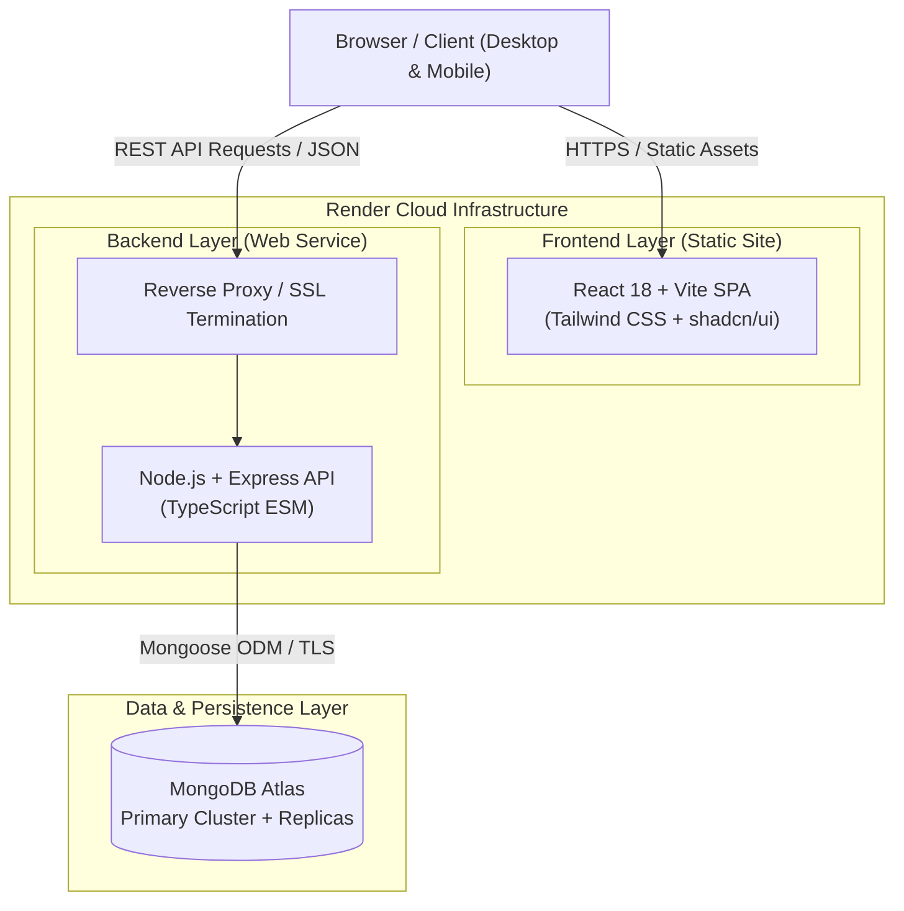
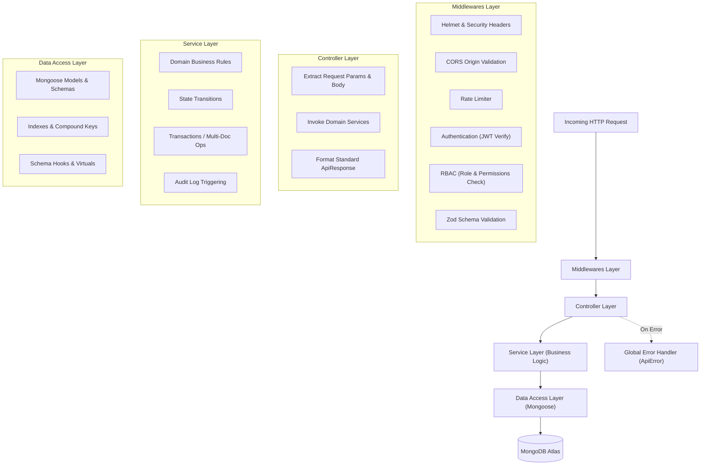

# ARCHITECTURE.md – UniverseByte CRM System Architecture

> **UniverseByte – Technology Redefined**  
> Comprehensive System Architecture & Engineering Blueprint

---

## 1. Executive Summary & Design Vision

**UniverseByte CRM** is an enterprise-grade web application engineered specifically for IT training institutes. The platform streamlines student lead acquisition, automated counseling workflows, course and cohort scheduling, admission conversions, and installment fee tracking.

The architecture emphasizes:
1. **Clean Layered Architecture:** Strict separation between routing, controllers, business services, and database models.
2. **Type Safety Across Boundaries:** End-to-end TypeScript from frontend user interface down to MongoDB Mongoose schemas.
3. **Defense in Depth Security:** Stateless JWT authentication, role-based access control, cryptographic password hashing, strict CORS, and Zod input validation.
4. **Cloud-Native Deployment:** Pre-configured for automated Render continuous deployment with isolated frontend static assets and backend API service.

---

## 2. System Context & Top-Level Architecture



---

## 3. Backend Layered Architecture

The backend follows the **Layered Clean Architecture** pattern. Each layer has a singular responsibility and communicates strictly with adjacent layers:



### Layer Rules:
1. **Router (`src/routes/`):** Defines URL patterns and associates them with validation middleware, authentication gates, role checks, and controller handlers.
2. **Controller (`src/controllers/`):** Purely handles the HTTP contract. It receives the request, delegates to the appropriate service, and formats the `ApiResponse`. It never directly interacts with Mongoose models.
3. **Service (`src/services/`):** Contains pure domain logic. It has no awareness of Express `req` or `res`. It accepts clean TypeScript objects and returns business results or throws `ApiError`.
4. **Model (`src/models/`):** Defines Mongoose schemas, indexes, types, and document validation.

---

## 4. Frontend Application Architecture

The frontend follows a **Feature-Driven Architecture**, colocating business logic, UI views, hooks, and API services by domain entity:

```
frontend/src/
  ├── components/
  │   ├── ui/               # Reusable primitive atomic components (shadcn/ui)
  │   ├── common/           # Domain-agnostic composite widgets (DataTable, StatCard)
  │   └── layout/           # App shell (Sidebar, Navbar, MobileDrawer)
  ├── context/              # Global state (AuthContext, ThemeContext)
  ├── features/             # Domain Feature Modules
  │   ├── auth/             # Login, Session Handling
  │   ├── leads/            # Lead Table, Kanban, Lead Detail, Filter Panel
  │   ├── followups/        # Agenda, Followup Modal, Reminder Badge
  │   ├── courses/          # Course Grid, Syllabus Viewer
  │   ├── batches/          # Batch Timeline, Capacity Meter
  │   ├── admissions/       # Conversion Wizard, Student Ledger
  │   └── reports/          # KPI Dashboard, Funnel Charts
  ├── hooks/                # Custom React hooks (useAuth, useDebounce, etc.)
  ├── lib/                  # Axios HTTP client, cn utility
  ├── routes/               # App Router, ProtectedRoute, RoleGuard
  ├── services/             # Typed API client SDK
  └── types/                # Domain types & interfaces
```

---

## 5. Security & Authentication Architecture

### 5.1 Token Strategy
- **Access Token:** Short-lived (15 minutes), signed with `JWT_ACCESS_SECRET`, stored in client memory or secure local storage, transmitted via the `Authorization: Bearer <token>` header.
- **Refresh Token:** Long-lived (7 days), signed with `JWT_REFRESH_SECRET`, stored in an `httpOnly`, `secure`, `sameSite: strict` cookie or authenticated payload to prevent XSS exfiltration.

### 5.2 Role-Based Access Control (RBAC)
User permissions are verified using a two-tier guard:
1. **Role Check:** Primary role assignment (`SuperAdmin`, `Admin`, `CounselorManager`, `Counselor`, `Accountant`, `Trainer`).
2. **Permission Check:** Granular action verification (`leads:read:all`, `leads:read:assigned`, `leads:delete`, `admissions:create`, `fees:record`, etc.).

### 5.3 Defense-in-Depth Measures
- **Helmet:** Sets secure HTTP response headers (`X-Content-Type-Options`, `X-Frame-Options`, `Strict-Transport-Security`).
- **CORS:** Restricts cross-origin requests strictly to designated frontend domains (`CORS_ORIGIN`).
- **Rate Limiting:** Protects against brute-force attacks on authentication routes (`/api/v1/auth/login`).
- **Password Security:** Salted hashes generated via `bcryptjs` with a work factor of 10. Passwords are never stored or logged in plain text.
- **Input Sanitization:** Every incoming request is parsed and validated through Zod schemas before touching any internal service.

---

## 6. Render Cloud Deployment Architecture

Render provides isolated environments for static assets and long-running services:

```
+-------------------------------------------------------+
|                    Render Cloud                       |
|                                                       |
|  +-------------------------+                          |
|  | Frontend: Static Site   |                          |
|  | - Vite Production Build |                          |
|  | - CDN Cached / Gzip     |                          |
|  | - SPA Rewrites enabled  |                          |
|  +------------+------------+                          |
|               | (API calls via HTTPS)                 |
|               v                                       |
|  +-------------------------+   +--------------------+ |
|  | Backend: Web Service    |   | MongoDB Atlas      | |
|  | - Node.js ESM Runtime   |-->| Cloud Cluster      | |
|  | - Port 10000            |   | - Primary/Replica  | |
|  | - Health: /api/v1/health|   | - Encrypted at rest| |
|  +-------------------------+   +--------------------+ |
+-------------------------------------------------------+
```

### Health Check Protocol:
- Path: `GET /api/v1/health`
- Evaluates:
  - Express event loop responsiveness
  - Active Mongoose connection state (`mongoose.connection.readyState === 1`)
  - Server uptime and memory allocation

